# Gestion des projets tutorés — Master 2 GDIL

**Projet de développement d’une application web à plusieurs tiers**
**Établissement : Université Gaston Berger de Saint-Louis**
**Formation : Master 2 GDIL**
**Documentation mise à jour le 16 octobre 2026**

Ce document présente le contexte, les fonctionnalités, la conception, l’installation et la validation de l’application. Il constitue la documentation générale du projet et une base pour le rapport et la soutenance.

Ce dépôt rassemble le backend de [mbackeCISSE](https://github.com/mbackeCISSE) et le frontend de [alimar440](https://github.com/alimar440/projets-tutores-frontend). Les informations administratives du rapport restent à compléter par les auteurs.

## Sommaire

1. Présentation et objectifs
2. Acteurs et fonctionnalités
3. Technologies et choix techniques
4. Architecture générale et organisation des sources
5. Modèle de données
6. Règles métier
7. Connexion et gestion des accès
8. Contrat API
9. Installation et lancement
10. Comptes de démonstration
11. Interface et parcours utilisateur
12. Tests et résultats
13. Scénario de soutenance et captures
14. Difficultés, limites et perspectives
15. Répartition du travail et documents associés

## 1. Présentation et objectifs

La gestion des projets tutorés mobilise plusieurs acteurs : les enseignants proposent des sujets, les étudiants déposent leurs candidatures et le responsable décide des affectations. L’administration gère les profils nécessaires à ce fonctionnement.

L’application centralise ces opérations afin de faciliter la consultation des sujets, le suivi des demandes et la gestion des capacités d’accueil.

Les objectifs sont les suivants :

- proposer un catalogue de sujets avec leur description, leur enseignant et leurs places restantes ;
- permettre aux étudiants de candidater avec une motivation ;
- donner aux enseignants une vue sur les candidatures à leurs propres sujets ;
- permettre au responsable d’accepter ou de rejeter les demandes en attente ;
- assurer la cohérence des affectations avec la capacité de chaque sujet ;
- fournir une interface adaptée à chaque rôle ;
- illustrer la séparation entre présentation, logique métier et persistance.

Le périmètre réalisé correspond à une application locale de démonstration. Les données métier sont persistées dans MySQL lorsque le mode API réelle est actif.

## 2. Acteurs et fonctionnalités

| Acteur | Fonctionnalités |
| --- | --- |
| Administrateur | Consulter, ajouter, modifier et supprimer des étudiants et des enseignants ; consulter tous les sujets. |
| Enseignant | Consulter ses sujets ; ajouter, modifier et supprimer ses propres sujets ; consulter les candidatures correspondantes. |
| Étudiant | Consulter les sujets disponibles ; déposer une candidature motivée ; suivre ses candidatures et leurs statuts. |
| Responsable | Consulter les sujets et les candidatures ; accepter ou rejeter les candidatures en attente ; consulter les affectations. |

Tous les acteurs utilisent une page de connexion par email et mot de passe. Le menu et les routes accessibles dépendent du rôle de l’utilisateur connecté.

Les affectations correspondent aux candidatures acceptées. Elles ne nécessitent ni table ni route supplémentaire.

## 3. Technologies et choix techniques

| Besoin | Technologie utilisée | Rôle |
| --- | --- | --- |
| Interface | Angular 19.2 et TypeScript 5.7 | Pages et composants. |
| Navigation | Routeur Angular et garde de rôle | Navigation et accès aux écrans. |
| Formulaires | Formulaires réactifs Angular | Saisie, validation et suivi des envois. |
| Communication | HttpClient et RxJS | Requêtes HTTP et traitement des réponses. |
| Présentation | HTML et CSS simples | Mise en page et adaptation aux écrans. |
| API | Spring Boot 4.1.1 et Spring Web MVC | Routes REST. |
| Langage backend | Java, cible de compilation 21 | Domaine et règles métier. |
| Persistance | Spring Data JPA et Hibernate | Entités, accès aux données et transactions. |
| Validation | Jakarta Bean Validation | Validation des requêtes reçues. |
| Base | MySQL 8.0.16+ ; MySQL 8.4 avec le fichier Compose fourni | Stockage durable et contraintes relationnelles. |
| Mots de passe | BCrypt via spring-security-crypto | Vérification des mots de passe de démonstration. |
| Construction backend | Maven Wrapper | Compilation, dépendances et tests. |
| Base locale isolée | Docker Compose | Démarrage de MySQL et volume persistant. |
| Tests frontend | Jasmine, Karma et Chrome Headless | Tests automatisés Angular. |
| Tests backend | JUnit, MockMvc et H2 | Tests des services, contrôleurs et règles métier. |

Le frontend n’utilise ni NgRx ni bibliothèque graphique. Le backend utilise des DTO simples et des conversions manuelles, sans Lombok ni MapStruct.

**Choix de base de données :** PostgreSQL figurait dans la demande initiale. Le dépôt backend livré utilise MySQL ; ce choix a été conservé lors de l’intégration. Les scripts SQL fournis sont des scripts MySQL.

Le backend provient de l’historique de ce dépôt, au commit **fdc826af1ef732fb54ab0c5f18ceacca6f40aa30**. Le frontend est importé depuis [alimar440/projets-tutores-frontend](https://github.com/alimar440/projets-tutores-frontend), au commit **a8f27352082754f726bb7a3fc7b3826e047e9612**. Leurs codes applicatifs sont conservés lors du regroupement. Un clone indépendant du frontend est également disponible localement dans `D:\developpement\angular_project\projets-tutores-frontend`.

## 4. Architecture générale et organisation des sources

L’application suit une architecture à trois tiers :

- **Présentation** : Angular affiche les écrans et collecte les saisies.
- **Application et logique métier** : Spring Boot valide les opérations et contrôle les rôles.
- **Données** : MySQL conserve les utilisateurs, sujets et candidatures.

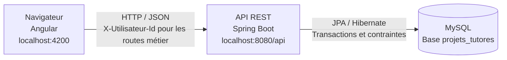

Docker est utilisé ici pour MySQL. Le frontend et le backend sont exécutés directement sur le poste de développement.

### 4.1. Répartition des responsabilités

| Élément | Responsabilité |
| --- | --- |
| Pages Angular | Présenter un écran, gérer les formulaires et déclencher les actions. |
| Composants Angular | Réutiliser l’en-tête, la navigation et les cartes de sujets. |
| Services Angular | Appeler l’API, gérer la connexion et conserver le profil courant en mémoire. |
| Garde Angular | Rediriger les accès aux pages non autorisées pour le profil. |
| Contrôleurs Spring | Recevoir les requêtes et exposer les réponses HTTP. |
| Services Spring | Appliquer les règles métier, les autorisations et les transactions. |
| Repositories | Interroger et modifier les données avec Spring Data JPA. |
| DTO | Définir les données reçues et renvoyées sans exposer directement les entités. |
| Gestion des exceptions | Transformer les erreurs en réponses HTTP au format commun. |

Les contrôles du frontend améliorent l’usage de l’application. Les contrôles métier restent appliqués côté backend.

### 4.2. Arborescence

```text
backend/  # racine du dépôt GitHub mbackeCISSE/backend
├── README.md
├── backend/
│   ├── pom.xml
│   ├── mvnw.cmd
│   ├── docs/
│   └── src/
│       ├── main/
│       │   ├── java/backend/backend/
│       │   │   ├── controller/
│       │   │   ├── dto/
│       │   │   ├── entity/
│       │   │   ├── exception/
│       │   │   ├── repository/
│       │   │   └── service/
│       │   └── resources/
│       │       ├── application.properties
│       │       ├── application-demo.properties
│       │       └── sql/
│       │           ├── schema.sql
│       │           ├── migration-connexion.sql
│       │           └── demo.sql
│       └── test/
├── frontend/
│   ├── package.json
│   ├── angular.json
│   ├── compose.mysql.yaml
│   ├── docs/
│   └── src/
│       ├── styles.css
│       └── app/
│           ├── components/
│           ├── guards/
│           ├── models/
│           ├── pages/
│           └── services/
└── capture/
```

Les dossiers frontend et backend sont suivis ensemble dans un seul dépôt Git. Le nom historique du dépôt GitHub reste backend, mais il contient désormais les deux applications, ce README et les captures. Le frontend est intégré comme des fichiers ordinaires, sans sous-module ni dépôt Git imbriqué.

## 5. Modèle de données

| Entité | Principaux attributs | Description |
| --- | --- | --- |
| Utilisateur | id, nom, prenom, email, role, motDePasseHash | Représente les quatre profils. |
| Sujet | id, titre, description, capaciteMax, ouvert, enseignant | Proposition déposée par un enseignant. |
| Candidature | id, etudiant, sujet, motivation, dateCandidature, statut | Demande d’un étudiant pour un sujet. |

Les étudiants et enseignants sont des utilisateurs différenciés par leur rôle. Aucun héritage JPA n’est utilisé.

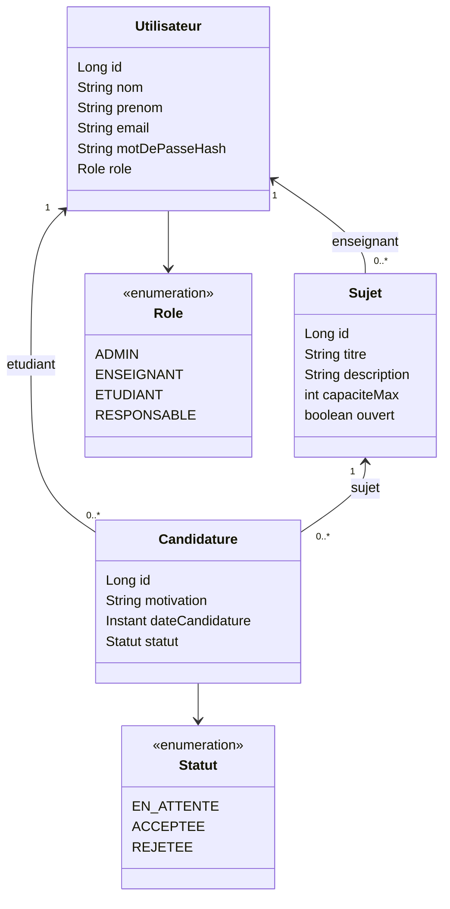

Les clés étrangères garantissent les relations. L’email est unique et une contrainte UNIQUE porte sur le couple étudiant/sujet. Les capacités sont des entiers supérieurs ou égaux à 1. Les rôles et statuts sont limités aux valeurs prévues.

Les dates sont renvoyées au format ISO 8601 en UTC. L’empreinte du mot de passe reste interne au backend.

Les valeurs suivantes sont calculées dans le backend et renvoyées dans le DTO Sujet :

```text
placesRestantes = capaciteMax - nombre de candidatures ACCEPTEE
disponible = ouvert ET placesRestantes > 0
```

Ces valeurs ne sont pas des compteurs modifiables directement depuis le frontend.

## 6. Règles métier

1. Une candidature est unique pour un même étudiant et un même sujet.
2. Un étudiant peut candidater à plusieurs sujets.
3. Une nouvelle candidature reçoit le statut EN_ATTENTE.
4. Une candidature n’est autorisée que sur un sujet ouvert disposant de places.
5. Un étudiant ayant déjà candidaté ne peut pas recommencer sur le même sujet, même après un rejet.
6. Seules les candidatures EN_ATTENTE peuvent faire l’objet d’une décision.
7. Le responsable peut accepter ou rejeter une candidature.
8. Une acceptation exige un sujet ouvert et une place restante.
9. La capacité ne peut pas devenir inférieure au nombre de candidatures déjà acceptées.
10. Un enseignant ne peut modifier ou supprimer que ses propres sujets.
11. Un sujet possédant des candidatures ne peut pas être supprimé.
12. Un utilisateur lié à des sujets ou à des candidatures ne peut pas être supprimé.

### 6.1. Décisions simultanées

Le backend utilise une transaction et un verrou pessimiste d’écriture sur le sujet lors des décisions et des modifications de capacité. Les transactions de modification concernées utilisent READ_COMMITTED. Les places sont vérifiées après acquisition du verrou pour éviter que des acceptations simultanées dépassent la capacité.

La cohérence repose sur la validation des saisies, les services métier, les transactions et les contraintes de la base.

### 6.2. Cycle d’une candidature

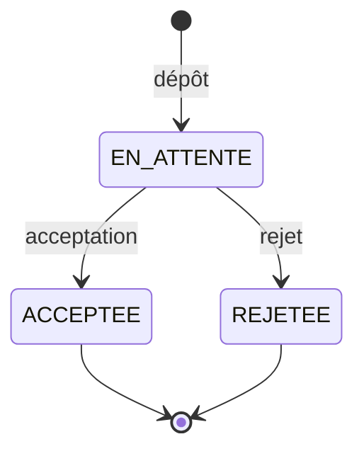

Le frontend affiche les libellés En attente, Acceptée et Rejetée.

## 7. Connexion et gestion des accès

La première version prévoyait une sélection de profil. Une page de connexion par email et mot de passe a ensuite été ajoutée et raccordée au backend.

1. Angular envoie les identifiants à POST /api/auth/connexion.
2. Le backend recherche le compte et vérifie le mot de passe avec BCrypt.
3. Il renvoie l’identité et le rôle, sans mot de passe ni empreinte.
4. Angular conserve cet objet dans SessionService, uniquement en mémoire.
5. Un intercepteur ajoute X-Utilisateur-Id aux requêtes métier.
6. Le backend charge l’utilisateur correspondant pour vérifier les rôles et permissions.
7. La déconnexion ou un rafraîchissement efface la session frontend.

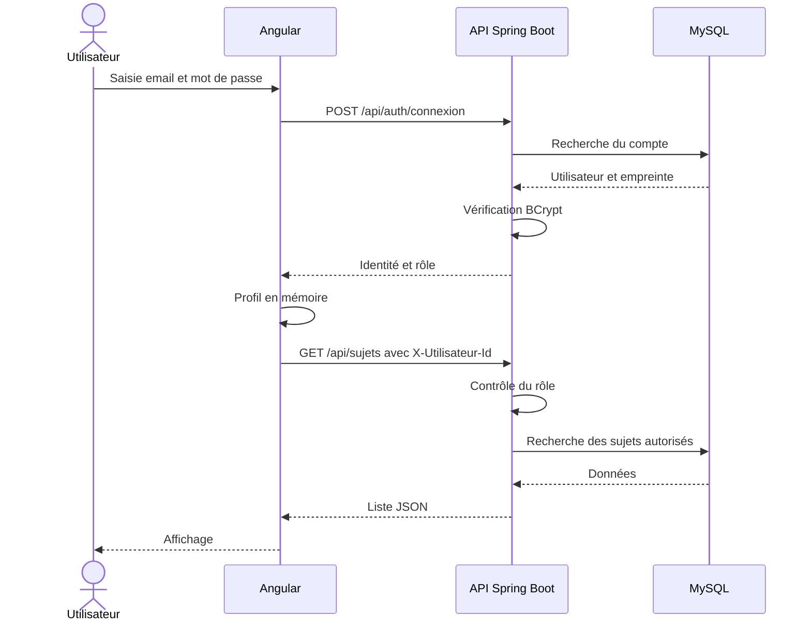

**Portée de la connexion :** il s’agit d’une simulation locale. Aucun JWT, cookie d’authentification ou session serveur n’est créé. X-Utilisateur-Id peut être falsifié et ne constitue pas une preuve d’identité. La vérification BCrypt ne suffit donc pas à qualifier ce mécanisme d’authentification de production.

Les mots de passe et empreintes ne sont jamais renvoyés dans les DTO. L’email est normalisé ; le mot de passe saisi est transmis sans modification.

Le profil demo initialise les comptes et les empreintes manquantes sans remplacer les empreintes existantes. Dans ce profil seulement, les étudiants et enseignants créés par ADMIN reçoivent le mot de passe initial commun.

## 8. Contrat API

Base : **http://localhost:8080/api**. Les routes ci-dessous sont relatives à cette base.

Les listes sont des tableaux JSON et les identifiants sont numériques. Le backend déduit l’étudiant ou l’enseignant de X-Utilisateur-Id ; ces identifiants ne sont pas envoyés dans les formulaires de candidature et de sujet.

| Méthode | Route | Accès |
| --- | --- | --- |
| POST | /auth/connexion | Sans en-tête utilisateur obligatoire. |
| GET | /utilisateurs-demo | Profil demo ; compatibilité avec l’ancienne sélection. |
| GET, POST | /etudiants | ADMIN. |
| PUT, DELETE | /etudiants/{id} | ADMIN. |
| GET, POST | /enseignants | ADMIN. |
| PUT, DELETE | /enseignants/{id} | ADMIN. |
| GET | /sujets | Tous les rôles ; liste filtrée selon le rôle. |
| POST | /sujets | ENSEIGNANT. |
| PUT, DELETE | /sujets/{id} | Enseignant propriétaire. |
| GET | /candidatures | Étudiant : les siennes ; enseignant : celles de ses sujets ; responsable : toutes. |
| POST | /candidatures | ETUDIANT. |
| PATCH | /candidatures/{id}/statut | RESPONSABLE. |

ADMIN ne peut pas consulter les candidatures. Les affectations filtrent les candidatures ACCEPTEE, sans route supplémentaire.

### 8.1. Corps des requêtes

| Opération | Corps JSON |
| --- | --- |
| Connexion | {"email":"aminata.diallo@gdil.example","motDePasse":"Projet2026!"} |
| Ajout ou modification d’une personne | {"nom":"Diallo","prenom":"Aminata","email":"aminata.diallo@gdil.example"} |
| Ajout ou modification d’un sujet | {"titre":"Sujet","description":"Description","capaciteMax":2,"ouvert":true} |
| Candidature | {"sujetId":1,"motivation":"Ma motivation"} |
| Décision | {"statut":"ACCEPTEE"} ou {"statut":"REJETEE"} |

Les identifiants des exemples sont indicatifs. Angular utilise ceux réellement renvoyés par le backend.

### 8.2. Réponses HTTP

| Code | Signification |
| --- | --- |
| 200 | Lecture, connexion, modification ou décision réussie. |
| 201 | Création réussie, avec l’objet créé. |
| 204 | Suppression réussie, sans corps. |
| 400 | Saisie ou en-tête utilisateur invalide. |
| 401 | Email ou mot de passe incorrect à la connexion. |
| 403 | Action interdite pour le rôle ou la propriété de la ressource. |
| 404 | Ressource introuvable. |
| 409 | Conflit métier : doublon, capacité, décision déjà prise ou ressource liée. |

Les erreurs suivent le format {"message":"Explication"}. La connexion renvoie le même message pour un email inconnu et un mauvais mot de passe.

Contrats détaillés : [backend](backend/docs/contrat-api.md) et [copie frontend](frontend/docs/contrat-api.md).

## 9. Installation et lancement

Les commandes suivantes sont prévues pour PowerShell et partent du dossier racine contenant frontend et backend.

### 9.1. Prérequis

- Node.js compatible avec Angular 19 ; Node 22 a été utilisé.
- npm.
- JDK 21 (cible de compilation du backend), avec JAVA_HOME configuré sur ce JDK.
- Docker Desktop démarré pour la base fournie, ou MySQL 8.0.16 ou supérieur.
- Internet pour télécharger les dépendances au premier lancement.

Le Maven Wrapper évite d’installer Maven séparément. Pour récupérer les deux applications sur un autre poste :

```powershell
git clone https://github.com/mbackeCISSE/backend.git projets-tutores
cd projets-tutores
```

### 9.2. Terminal 1 — MySQL

```powershell
docker compose -f frontend/compose.mysql.yaml up -d
docker compose -f frontend/compose.mysql.yaml ps
```

Attendre que le service soit indiqué healthy.

| Paramètre local | Valeur |
| --- | --- |
| Hôte | 127.0.0.1 |
| Port depuis Windows | 3307 |
| Port dans le conteneur | 3306 |
| Base | projets_tutores |
| Utilisateur | root |
| Mot de passe SQL local | ProjetsLocal2026! |
| Persistance | Volume mysql-data, préfixé par le projet Compose. |

Ces identifiants SQL sont réservés à la base locale de démonstration. Ils sont distincts des comptes de l’application.

### 9.3. Terminal 2 — Spring Boot

Vérifier que `java -version` indique un JDK 21 et adapter JAVA_HOME à son installation.

```powershell
cd backend
$env:DB_URL = 'jdbc:mysql://localhost:3307/projets_tutores?createDatabaseIfNotExist=true&serverTimezone=UTC&allowPublicKeyRetrieval=true&useSSL=false'
$env:DB_USERNAME = 'root'
$env:DB_PASSWORD = 'ProjetsLocal2026!'
.\mvnw.cmd spring-boot:run "-Dspring-boot.run.profiles=demo"
```

Alternative avec votre serveur MySQL déjà installé sur le port 3306 (sans Docker) : utiliser `jdbc:mysql://localhost:3306/projets_tutores?createDatabaseIfNotExist=true&serverTimezone=UTC` pour DB_URL et vos identifiants MySQL pour DB_USERNAME et DB_PASSWORD. Ne pas lancer simultanément deux backends sur le port 8080.

Ces variables s’appliquent au terminal courant. Avec une installation MySQL personnelle, utiliser ses propres paramètres de connexion. Les options JDBC ci-dessus correspondent uniquement à la base locale Docker.

Le profil demo doit être activé explicitement pour initialiser les comptes fictifs. L’API écoute sur **http://localhost:8080/api**.

### 9.4. Terminal 3 — Angular

```powershell
cd frontend
npm.cmd ci
npm.cmd start
```

Ouvrir **http://localhost:4200**. npm.cmd évite le blocage éventuel de npm.ps1 sous PowerShell ; les commandes npm classiques restent utilisables dans les autres environnements.

Le backend autorise par CORS l’origine http://localhost:4200, les méthodes métier et les en-têtes Content-Type et X-Utilisateur-Id. Une autre origine doit être autorisée explicitement.

### 9.5. Initialisation et persistance

Au démarrage, le backend exécute le schéma et la migration. La migration ajoute la colonne d’empreinte si nécessaire et normalise les emails sans supprimer les relations. Le profil demo insère les exemples et initialise les empreintes manquantes. Hibernate valide le schéma.

Les doublons éventuels d’emails après normalisation doivent être résolus avant migration. Les données restent dans le volume MySQL après arrêt ; un rafraîchissement efface seulement la session Angular.

### 9.6. Mode mock facultatif

Dans [app.config.ts](frontend/src/app/app.config.ts), MOCK_ENABLED vaut **false** : les requêtes vont vers Spring Boot.

La valeur true permet de travailler hors ligne avec [mock-data.ts](frontend/src/app/services/mock-data.ts). Les modifications restent alors en mémoire, disparaissent au rafraîchissement et ne sont pas synchronisées avec MySQL. L’application ne bascule pas automatiquement en mock si le backend est indisponible.

### 9.7. Arrêt et dépannage

Arrêter Angular et Spring Boot avec Ctrl+C dans leurs terminaux. Depuis la racine, arrêter MySQL sans supprimer ses données :

```powershell
docker compose -f frontend/compose.mysql.yaml stop
```

| Problème | Vérification |
| --- | --- |
| Serveur inaccessible dans Angular | Vérifier Spring Boot sur 8080, MySQL et DB_URL. |
| Erreur Java liée à release 21 | Corriger JAVA_HOME vers un JDK compatible. |
| Compte fictif refusé | Vérifier le profil demo, l’email et le mot de passe. |
| Connexion SQL refusée | Vérifier le port 3307, les identifiants SQL et l’état healthy. |
| Erreur CORS | Ouvrir le frontend via http://localhost:4200. |
| Port 4200 ou 8080 occupé | Identifier le processus existant avant de lancer une deuxième instance. |
| Données différentes des mocks | Vérifier MOCK_ENABLED : le mode réel affiche MySQL. |

## 10. Comptes de démonstration

| Rôle | Profil | Adresse email | Mot de passe |
| --- | --- | --- | --- |
| Administrateur | Fatou Ndiaye | fatou.ndiaye@gdil.example | Projet2026! |
| Enseignant | Moussa Diop | moussa.diop@gdil.example | Projet2026! |
| Enseignante | Awa Fall | awa.fall@gdil.example | Projet2026! |
| Étudiante | Aminata Diallo | aminata.diallo@gdil.example | Projet2026! |
| Étudiant | Ibrahima Sarr | ibrahima.sarr@gdil.example | Projet2026! |
| Étudiante | Mariama Ba | mariama.ba@gdil.example | Projet2026! |
| Responsable | Cheikh Seck | cheikh.seck@gdil.example | Projet2026! |

Ces comptes sont fictifs. Le mot de passe initial commun est public et réservé aux essais locaux.

## 11. Interface et parcours utilisateur

L’interface est en français. Elle utilise actuellement un menu bleu nuit, un fond gris perle et des surfaces claires. Le lien actif est indiqué par son fond, sans bordure latérale décorative. Sur téléphone, la navigation passe au-dessus du contenu et les tableaux défilent dans leur conteneur.

Les comportements réalisés comprennent la validation des champs et emails, la capacité entière positive, les messages de chargement et listes vides, les erreurs backend, la désactivation des envois en cours, la confirmation des suppressions et l’actualisation des données après action.

Un sujet affiche Déjà candidaté pour une candidature existante, même rejetée. Les boutons de décision ne sont visibles que pour les demandes en attente. Les places sont rechargées après décision.

| Route frontend | Écran |
| --- | --- |
| /connexion | Connexion. |
| /etudiants | Gestion des étudiants pour ADMIN. |
| /enseignants | Gestion des enseignants pour ADMIN. |
| /sujets | Sujets filtrés selon le rôle. |
| /candidatures | Candidatures filtrées selon le rôle, hors ADMIN. |
| /affectations | Candidatures acceptées pour RESPONSABLE. |

Sans utilisateur connecté, les routes protégées redirigent vers la connexion.

## 12. Tests et résultats

### 12.1. Vérifications du regroupement

Les résultats effectivement obtenus lors de ce regroupement sont consignés dans [docs/regroupement.md](docs/regroupement.md). Les commandes sont exécutées depuis les sous-dossiers du dépôt commun.

| Verification du regroupement | Resultat |
| --- | --- |
| Compilation Angular de production avec Node 22 | Reussie. |
| Tests Angular dans Chrome Headless | 21 tests reussis. |
| Compilation Maven et generation du JAR avec Java 21 | Reussies. |
| Tests backend H2 | 15 tests reussis. |
| Tests MySQL optionnels et parcours navigateur complet | Non rejoues pendant ce regroupement. |
| Sources applicatives, captures et liens locaux du README | Conservation et presence verifiees. |


```powershell
cd frontend
npm.cmd ci
npm.cmd run build
npm.cmd test -- --watch=false --browsers=ChromeHeadless
```

Chrome doit être installé ; si nécessaire, définir CHROME_BIN avec le chemin de son exécutable. Angular 19 demande une version compatible de Node.js, notamment Node 22.

Dans un autre terminal, depuis la racine :

```powershell
cd backend
.\mvnw.cmd package
```

Les rapports Maven sont générés dans backend/target/surefire-reports. Les tests MySQL optionnels ciblent localhost:3306, et non automatiquement le port 3307 du service Compose. Leur commande est décrite dans le README backend.

### 12.2. Vérifications antérieures documentées

Le backend a précédemment été compilé et vérifié avec 15 tests H2 et 15 tests MySQL. Le frontend rapporte 21 tests Angular, une compilation de production et un parcours navigateur Angular → Spring Boot → MySQL réussis dans [frontend/docs/verification.md](frontend/docs/verification.md). Ce document est conservé comme historique de l’intégration précédente ; ces résultats ne sont pas présentés comme un nouveau parcours navigateur réalisé pendant le regroupement.

## 13. Scénario de soutenance et captures

### 13.1. Démonstration conseillée

1. Présenter l’architecture et le rôle de chaque tiers.
2. Se connecter en ADMIN et montrer la gestion des étudiants et enseignants.
3. Se connecter avec Moussa Diop et créer un sujet ouvert de capacité 1.
4. Se connecter avec Aminata Diallo, consulter le sujet et déposer une motivation.
5. Montrer le statut En attente et l’indication Déjà candidaté.
6. Revenir à l’enseignant pour montrer la candidature reçue.
7. Se connecter avec Cheikh Seck et accepter la candidature.
8. Montrer la mise à jour des places et la liste des affectations.
9. Revenir à l’étudiante et présenter le résultat.
10. Rafraîchir : expliquer la disparition de la session et la conservation des données.
11. Sur un autre sujet, illustrer un rejet et l’impossibilité de candidater de nouveau.
12. Présenter une validation de formulaire et un refus métier.

Pour rejouer le scénario, créer un nouveau sujet afin d’éviter la contrainte de candidature unique sur les sujets déjà utilisés.

### 13.2. Captures du rapport

| Capture | Éléments à montrer |
| --- | --- |
| Connexion | Formulaire et traitement d’une erreur. |
| Administration | Liste des personnes et formulaire de modification. |
| Sujets enseignant | Ses sujets et formulaire de création. |
| Sujets étudiant | Description, encadrant, places et candidature. |
| Dépôt de candidature | Motivation et confirmation. |
| Suivi étudiant | Statuts et indication Déjà candidaté. |
| Décision responsable | Candidature en attente et actions Accepter/Rejeter. |
| Affectations | Candidature acceptée et données actualisées. |
| Règle métier | Conflit ou validation explicite. |
| Téléphone | Connexion, navigation et présentation des listes. |

Les 11 captures fournies avec le README de référence sont maintenant incluses dans [capture/](capture/). Elles illustrent l’interface existante ; elles n’ont pas été recréées pendant ce regroupement.

#### Connexion

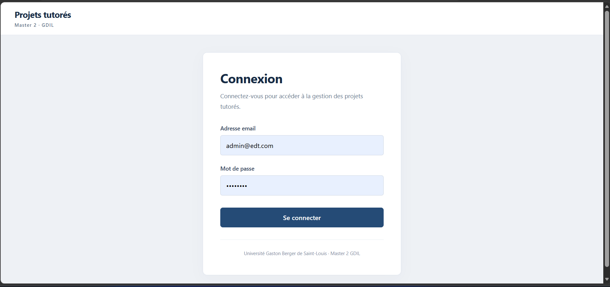

#### Administration

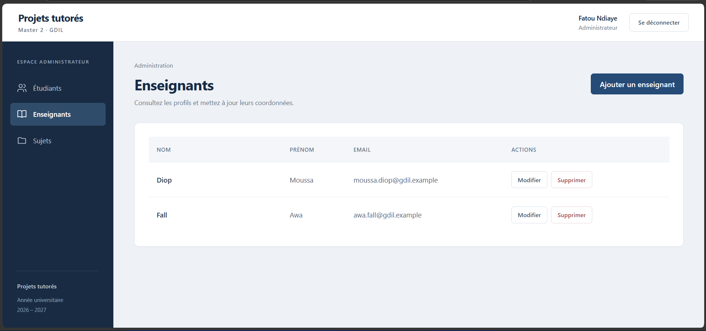

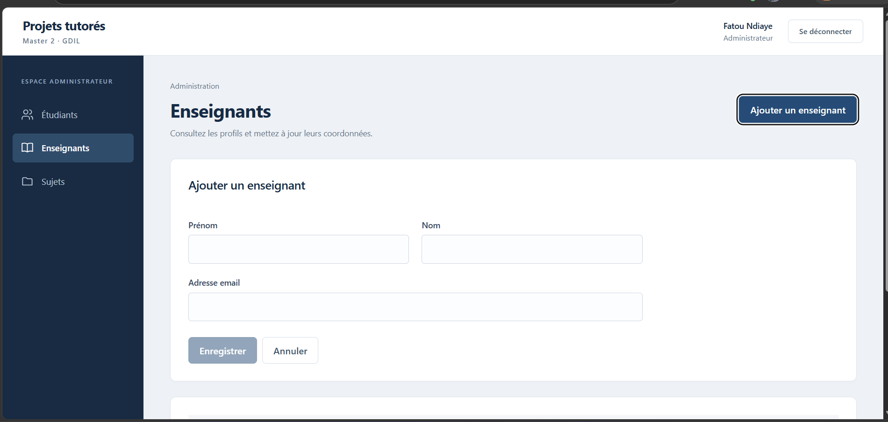

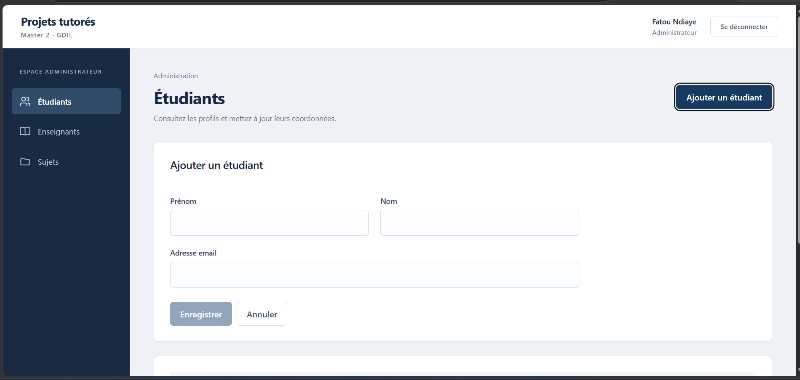

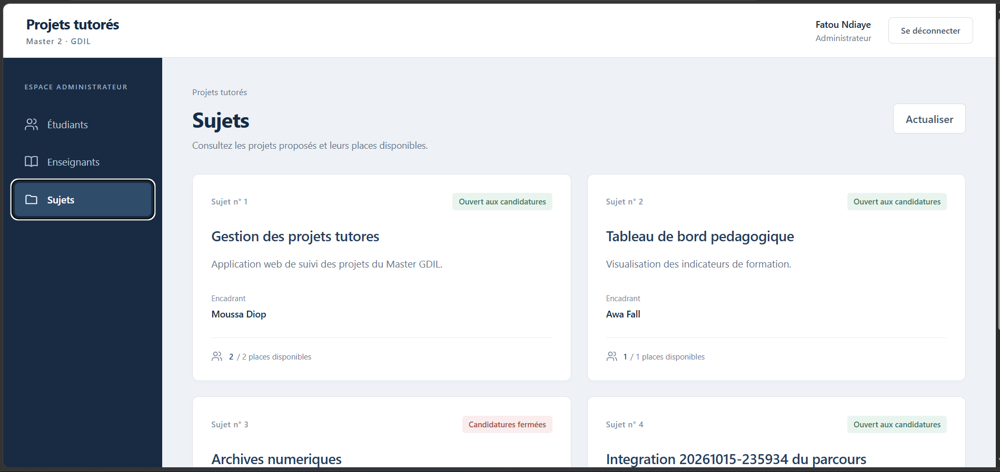

#### Enseignant

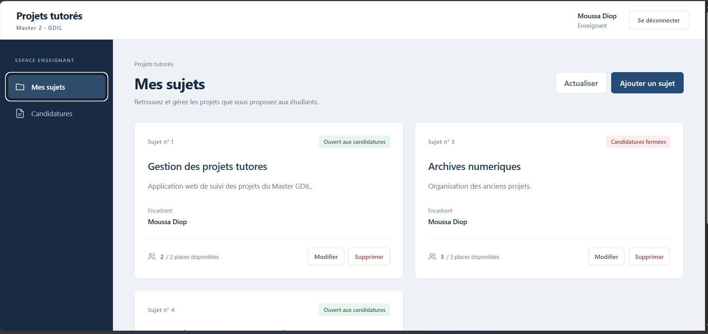

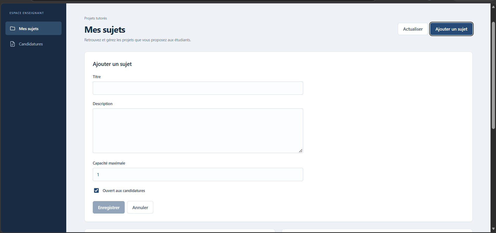

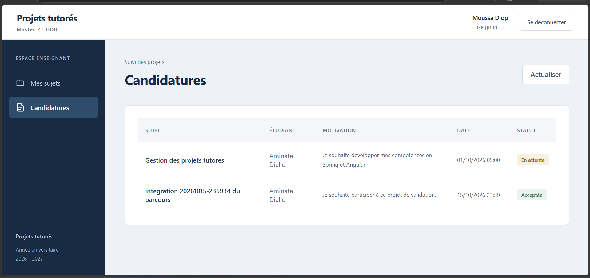

#### Étudiant

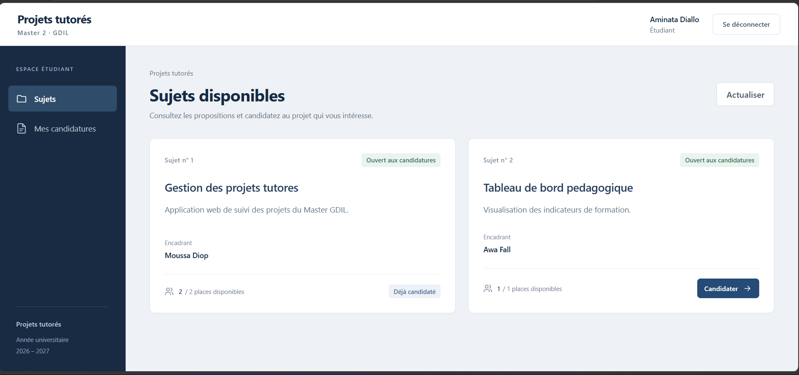

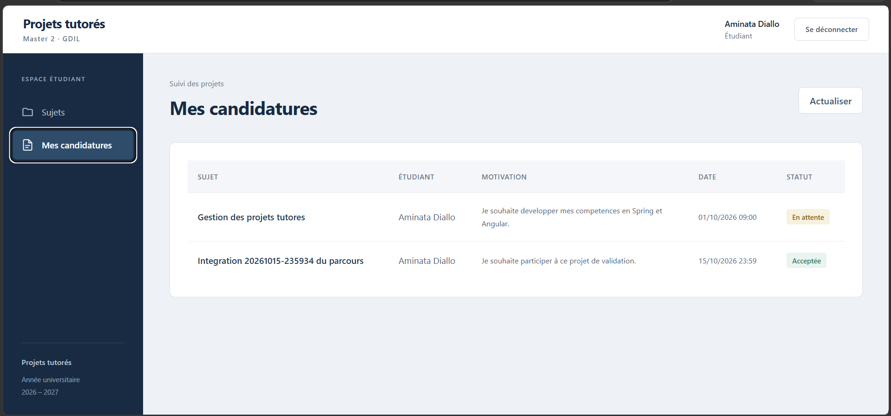

#### Responsable

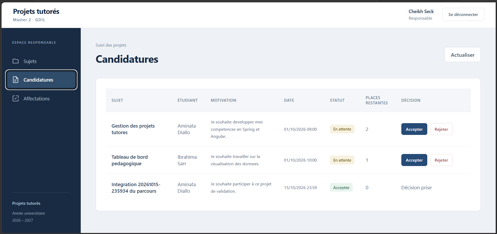

Les captures temporaires des vérifications sont distinctes des illustrations finales du rapport. Une liste complémentaire figure dans [captures-rapport.md](frontend/docs/captures-rapport.md).

## 14. Difficultés, limites et perspectives

### 14.1. Points traités

| Point | Traitement réalisé |
| --- | --- |
| Développement séparé | Vérification des DTO et du contrat avant raccordement. |
| Frontend disponible avant le backend | Mocks temporaires, puis API réelle activée par défaut. |
| Connexion ajoutée après la première demande | Nouvelle route backend et adaptation d’AuthService. |
| PostgreSQL demandé, MySQL livré | Conservation et documentation du choix réel. |
| JAVA_HOME pointant vers Java 17 | Sélection d’un JDK compatible avec la cible 21. |
| Absence de MySQL prêt pour les essais | Base isolée avec Docker Compose. |
| Acceptations concurrentes | Transactions et verrou sur le sujet. |
| Cohérence de l’interface après action | Rechargement des données depuis l’API. |

### 14.2. Limites actuelles

- La connexion est une simulation locale basée sur un identifiant transmis par le navigateur.
- La récupération et le changement autonome du mot de passe ne sont pas implémentés.
- La session Angular ne survit pas au rafraîchissement.
- Les listes sont retournées sans pagination.
- Les notifications et le dépôt de fichiers ne sont pas implémentés.
- Un étudiant peut candidater à plusieurs sujets ; aucune règle d’affectation unique par étudiant n’a été ajoutée.
- Le déploiement sur un serveur de production n’a pas été réalisé ni validé.
- Les mocks et MySQL sont indépendants.

### 14.3. Perspectives

Ces points sont des évolutions possibles, pas des fonctionnalités déjà livrées : authentification de production, gestion complète des mots de passe, pagination et recherche, historique des décisions, notifications, périodes de candidature, gestion des promotions, export des affectations, intégration continue et déploiement reproductible des trois tiers.

## 15. Répartition du travail et documents associés

Le projet est réalisé en binôme :

| Partie | Travail |
| --- | --- |
| Frontend | Pages, composants, services HTTP, formulaires, navigation, présentation et tests Angular. |
| Backend | Modèle JPA, API REST, base relationnelle, règles métier, connexion et tests backend. |
| Intégration | Contrat, raccordement, configuration locale, essais entre rôles et documentation. |

Les auteurs peuvent compléter cette répartition avec leurs noms et leurs contributions précises.

| Ressource | Contenu |
| --- | --- |
| [README frontend](frontend/README.md) | Lancement Angular, connexion et configuration API/mock. |
| [README backend](backend/README.md) | Configuration Spring Boot, SQL et tests backend. |
| [Contrat API](backend/docs/contrat-api.md) | Routes, DTO, codes HTTP et règles. |
| [Diagramme de classes](backend/docs/diagramme-classes.md) | Modèle métier Mermaid. |
| [Vérifications d’intégration](frontend/docs/verification.md) | Résultats réels et limites des contrôles. |
| [Captures conseillées](frontend/docs/captures-rapport.md) | Écrans utiles pour le rapport. |
| [Configuration MySQL](frontend/compose.mysql.yaml) | Base locale et volume Docker. |
| [Schéma SQL](backend/src/main/resources/sql/schema.sql) | Tables et contraintes. |
| [Migration de connexion](backend/src/main/resources/sql/migration-connexion.sql) | Évolution pour les empreintes de mots de passe. |
| [Données de démonstration](backend/src/main/resources/sql/demo.sql) | Initialisation des exemples. |
