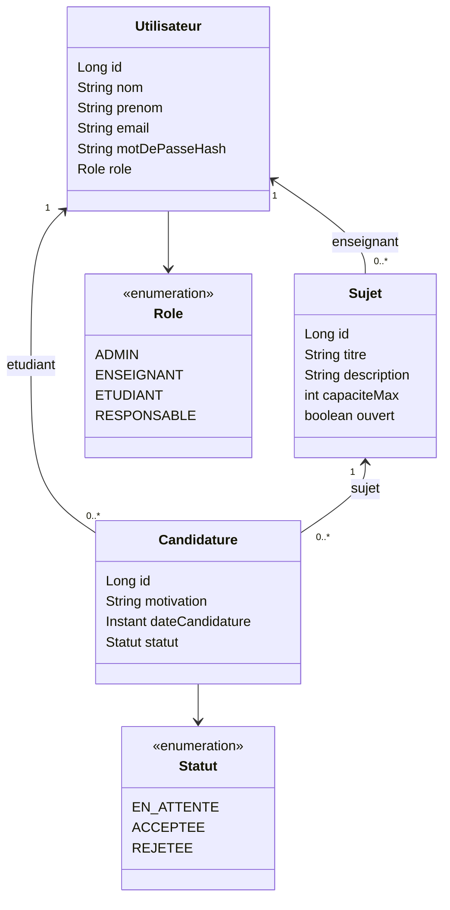

# Diagramme de classe

Les roles remplacent tout heritage JPA. Les affectations sont les candidatures ACCEPTEE.
Les DTO exposent les identifiants des relations et les noms complets (prenom puis nom).

Le motDePasseHash est une empreinte BCrypt interne, absente des DTO et des reponses HTTP.
